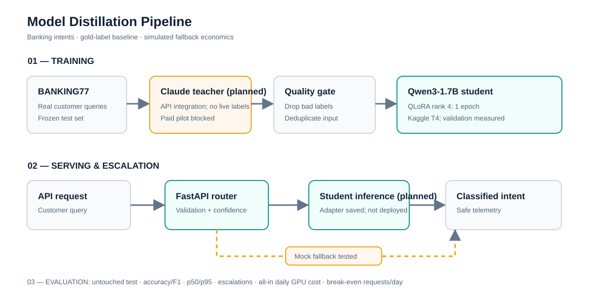

# Model Distillation Pipeline — From Claude API to Qwen3-8B

**An end-to-end 77-intent banking support classification system with teacher-supervised LoRA/QLoRA, vLLM routing, and a break-even cost model.** Implementation and offline tests are ready; model quality, GPU throughput, and cost savings are **not yet measured**.



## Results first

> **Status: Evaluation pending.** Do not quote a quality percentage, cost reduction, or break-even volume until the real runs described below have completed.

| Measure | Claude teacher | Qwen3-8B student | Student + teacher fallback |
| --- | ---: | ---: | ---: |
| Accuracy (official held-out test) | Pending | Pending | Pending |
| Macro-F1 | Pending | Pending | Pending |
| p50 / p95 latency | Pending | Pending | Pending |
| Cost / 1,000 requests at stated daily volume | Pending | Pending | Pending |
| Escalation rate | — | — | Pending |
| Break-even requests / day | — | — | Pending |

After actual evaluation, `distill benchmark` creates `reports/benchmark/benchmark.md`, and `distill economics` exports a concrete break-even volume or explains why none exists under the assumptions.

## Why this project?

A frontier-model API is attractive when traffic is low, but costs may accumulate when a repeated task can be delegated to a smaller hosted model. **The cost comparison is not automatically favorable to self-hosting**: continuously rented GPU capacity, idle time, operational overhead, latency constraints and teacher escalations can reverse the answer.

This repository isolates one narrow capability: assigning customer support messages to BANKING77's 77 documented intents. It uses actual customer-query examples rather than synthetic instruction prompts. The public dataset contains 10,003 training examples and 3,080 official test examples. Source: [PolyAI/BANKING77](https://huggingface.co/datasets/PolyAI/banking77), distributed under CC BY 4.0. Authors: Casanueva et al. (2020), *Efficient Intent Detection with Dual Sentence Encoders*.

### Technology

Python · Hugging Face Datasets/Transformers · PyTorch · TRL/PEFT · Anthropic Claude API · Weights & Biases · Qwen3-8B · vLLM · FastAPI · pytest

### Architecture

1. **Prepare** the real BANKING77 data. Stratified validation split from the original training portion; original test rows remain untouched. Remove exact and very similar training examples that overlap the validation set; the official test set is not used to select or filter training data.
2. **Teacher** (Claude) predicts labels into a strict JSON schema; actual API token usage and failed outputs are recorded. The primary distillation run accepts schema-valid teacher labels regardless of the available gold label; a gold-agreement filter is an optional ablation.
3. **Student** (Qwen3-8B) learns on valid teacher-labeled examples using completion-only supervised fine-tuning; compare rank 8 and rank 32 adapters and a gold-supervised control. W&B records loss, schedule and validation loss. Checkpoint validator records generated-label accuracy and sample predictions.
4. **Serve** LoRA adapters via vLLM's OpenAI-compatible server. A FastAPI router validates predictions and escalates failures or outputs below a validation-chosen confidence-proxy threshold to Claude.
5. **Evaluate** all systems against the same held-out gold labels. Measure errors, quality, p50/p95 latency, observed escalation and actual token usage. Load-test the endpoint at increasing concurrency.
6. **Cost model** combines teacher token price, continuously paid GPU rental, daily operations, setup amortization, additional variable cost, and paid teacher fallback.

The architecture image shows the training path and online fallback separately; it is intentionally a data-path diagram rather than a framework-class diagram.

## Quick start: no API expense

Use Python 3.11 or 3.12 for the training environment, an NVIDIA CUDA GPU for 8B fine-tuning/serving, and the correct CUDA-compatible PyTorch and vLLM builds. Normal tests require no GPU or credentials.

```bash
python -m venv .venv
source .venv/bin/activate
python -m pip install -e '.[dev]'
pytest -q
python demo/offline_demo.py
```

Expected: the unit tests pass and the demo prints a **fixture-only** example of the router using the student and escalating to the teacher. These are not model accuracy measurements.

## Reproduce the real experiment

All commands run from the repository root. Outputs and downloaded datasets are deliberately ignored by Git. The dataset itself is not bundled in this repository.

**1 — Create frozen splits**

```bash
distill prepare --out data/processed --seed 42
cat data/processed/manifest.json
```

**2 — Measure teacher feasibility on validation before training.** Set your real key in `.env`, using `.env.example` as a template. Confirm current prices on [Claude pricing](https://platform.claude.com/docs/en/about-claude/pricing); CLI prices are **USD per million tokens**. The example prices below illustrate the configuration for Sonnet 4.6 and must be checked before spending.

```bash
cp .env.example .env
# Edit .env with ANTHROPIC_API_KEY; never commit it.

distill label-teacher \
  --input data/processed/validation.jsonl \
  --output data/teacher/validation.jsonl \
  --limit 100 --execute-paid --budget-usd 2 \
  --input-price 3 --output-price 15
```

Check teacher accuracy against the real gold labels before scaling:

```bash
distill score --predictions data/teacher/validation.jsonl
```

The teacher is **not a mathematical upper bound** on student accuracy: humans supplied labeled data independently. Weak teacher performance is a warning to reconsider distillation before spending on GPUs.

**3 — Generate training supervision.** Teacher labeling is an opt-in paid action. Start with a small subset; increase `--limit` toward your chosen target only after checking error rates and spend.

```bash
distill label-teacher \
  --input data/processed/train.jsonl \
  --output data/teacher/train.jsonl \
  --limit 100 --execute-paid --budget-usd 3 \
  --input-price 3 --output-price 15

distill build-sft \
  --teacher data/teacher/train.jsonl \
  --out data/processed
```

The default CLI limit is intentionally small. **A 100-example pilot is not a credible final distillation training run.** Plan to collect several thousand accepted examples. `filter_report.json` shows invalid outputs, teacher disagreement with gold and accepted count. **By default, gold-disagreeing but schema-valid teacher labels remain**: this is genuine teacher-supervised distillation rather than silently replacing teacher outputs with human labels. To assess the effect of excluding wrong labels, run `distill build-sft --require-gold-agreement --out data/gold-filter-ablation` as a separate experiment.

**Crucial control — fine-tuning directly from existing gold labels:**

```bash
distill build-gold-baseline \
  --match-teacher data/teacher/train.jsonl \
  --out data/gold-baseline

python scripts/train.py --rank 8 --run-name banking77-gold-r8 \
  --train data/gold-baseline/sft_train.jsonl \
  --validation data/gold-baseline/sft_validation.jsonl
```

This uses the same original text IDs where valid teacher annotations exist, making the comparison fairer. A gold-labeled dataset means it is entirely possible that **paying the teacher adds no value**. A strong portfolio project reports that negative result rather than trying to hide it.

**4 — Fine-tune two student configurations.** Install GPU dependencies in the CUDA environment and configure W&B (or use `--no-wandb`). This stage rents/uses GPU resources, so run it only when you approve that spend.

```bash
python -m pip install -e '.[train]'
export WANDB_PROJECT=banking77-model-distillation
python scripts/train.py --rank 8  --run-name banking77-qlora-r8
python scripts/train.py --rank 32 --run-name banking77-qlora-r32
```

Checkpoints save per epoch. For generated-label validation and sample outputs at each checkpoint, optionally log to W&B:

```bash
python scripts/validate_checkpoints.py \
  --run-dir outputs/train/banking77-qlora-r8 --limit 200 --wandb
```

Rank 32 may require more VRAM, and a single "winning" configuration must be selected **only using validation**, not the test set.

**5 — Serve the LoRA adapter and online fallback.** Install `vllm` in an appropriate *separate* GPU environment, start the server, then use the lightweight FastAPI environment for the router.

```bash
ADAPTER_PATH=outputs/train/banking77-qlora-r8/final-adapter bash scripts/serve_vllm.sh
# In a second terminal with project package and configured .env:
uvicorn distill_lab.api:app --host 127.0.0.1 --port 8080
curl -s http://127.0.0.1:8080/health
curl -s http://127.0.0.1:8080/classify \
  -H 'content-type: application/json' \
  -d '{"text":"I need to change the PIN on my card"}'
```

Live `/classify` might incur paid Claude calls when the student fails. It defaults to escalation on validation errors or provider failures; confidence gating is **disabled until validated**. Once calibrated on validation, add `ROUTER_MIN_CONFIDENCE=YOUR_VALUE` to `.env`. The proxy uses output-token log likelihood; it is **not a calibrated posterior probability**.

**6 — Benchmark on validation before a once-only official test.** Use identical prompts, hardware/region where possible, warmup conditions and concurrency for defensible latency comparisons. `--execute-paid` is mandatory for teacher evaluation. Adjust model IDs/prices from the current provider documentation.

```bash
# Development round (pilot, explicitly not official test results):
distill evaluate --provider student --limit 100 --concurrency 1 \
  --output outputs/eval/student_validation.jsonl

distill evaluate --provider teacher --limit 100 --execute-paid \
  --budget-usd 3 --input-price 3 --output-price 15 \
  --output outputs/eval/teacher_validation.jsonl

distill benchmark \
  --teacher outputs/eval/teacher_validation.jsonl \
  --student outputs/eval/student_validation.jsonl \
  --out reports/validation
```

For **final** results, switch each evaluation source to `data/processed/test.jsonl`, add `--confirm-final-test`, remove pilot limits, and increase the teacher spend budget to cover all 3,080 rows; if paid evaluation truncates due to budget, `distill benchmark --expected 3080` refuses to label it a complete official test. Never use these test results to retune prompts, choose models or change thresholds.

**7 — Measure throughput, escalation, and break-even.** First run a served load test; vary concurrency and determine which sustainable RPS meets your latency SLO. Model prices and GPU rental are explicit scenario inputs, never hard-coded benchmark results.

```bash
python scripts/load_test.py --p95-slo-ms 1500 --concurrency 1 2 4 8 \
  --source data/processed/validation.jsonl --limit 100 --repeats 1 \
  --acknowledge-possible-paid-fallback

# Run a separate router evaluation to measure the actual fallback fraction.
distill evaluate --provider router --limit 100 --execute-paid \
  --budget-usd 3 --input-price 3 --output-price 15 \
  --output outputs/eval/router_validation.jsonl

# Replace 1.25 USD/hour with YOUR actual reserved/spot/on-demand rate.
# The 1.25 in this command is a SCENARIO assumption, not a measured cloud price.
distill economics \
  --teacher-predictions outputs/eval/teacher_validation.jsonl \
  --router-predictions outputs/eval/router_validation.jsonl \
  --teacher-input-price 3 --teacher-output-price 15 \
  --gpu-hourly 1.25 --ops-per-day 0 \
  --requests-per-day 10000 --out reports/economics.json

# Once student, teacher AND router evaluations are available:
distill benchmark \
  --teacher outputs/eval/teacher_validation.jsonl \
  --student outputs/eval/student_validation.jsonl \
  --router outputs/eval/router_validation.jsonl \
  --out reports/validation

distill report --benchmark reports/validation/benchmark.json \
  --economics reports/economics.json \
  --out reports/three_axis.md
```

The cost model outputs an **undefined break-even** when the student is never cheaper per request after escalation and variable costs. Even a positive break-even is impractical if it exceeds measured throughput under your p95 SLA; supply `--acceptable-rps` to make that explicit.

## Cost logic

For an **always-on GPU**:

- `fixed_per_day = 24 × gpu_hourly + operations_per_day + amortized_setup_per_day`
- `student_marginal_per_request = student_variable_per_request + escalation_rate × teacher_cost_per_request`
- `teacher_day = daily_requests × teacher_cost_per_request`
- `student_day = fixed_per_day + daily_requests × student_marginal_per_request`
- `break_even = first integer daily volume such that student_day < teacher_day`

Actual teacher unit price comes from API-reported input/output token usage times user-supplied current model prices. Pricing limitations: cached-token rates, provider service tiers, taxes, output retries, load-test overhead, training-label generation, GPU warmup and failed billed requests may require separate accounting. The results are a **workload-specific estimate**, not guaranteed enterprise savings.

## Design decisions and trade-offs

**Narrow real task over general chat.** BANKING77 has externally annotated intent labels, so a student/teacher comparison can be grounded in more than subjective LLM judging. Downside: 77 highly similar classes are difficult, and the benchmark may not reflect a particular bank's real traffic distribution.

**Teacher-only supervision versus existing gold labels.** The default student learns valid Claude labels; a separate gold-supervised control uses the same input examples. This answers the critical question of whether paying a teacher improves anything when labels already exist. An optional agreement-filtered ablation drops teacher mistakes, but may bias training toward easy queries. No distillation ROI should be claimed without this comparison.

**Constrained labels + explicit fallback.** vLLM choice constraints prevent outputs outside the label taxonomy under supported engines, and FastAPI sends invalid/error or threshold-flagged requests to Claude. Downside: forced choice cannot recognize out-of-scope requests; a new `other` or abstention design would need a distinct dataset and assessment. The logprob proxy is uncalibrated until a validation study.

## What did not work / limitations

This starter repository has **no recorded full teacher labeling run, no GPU-training experiment, and no production traffic**. Therefore it would be misleading to invent failed hyperparameter trials, claim a measured speedup, or fill the scorecard with flattering estimates. Genuine failure analysis belongs here after experiments.

Known risks to test, not purported completed failures:

- Near-duplicate semantic paraphrases may remain after character-shingle filtering; audit train/validation/test pairs manually or with embedding similarity.
- Model confidence proxy might be overconfident, so calibration must be measured before enabling a quality-based fallback threshold.
- Low traffic may keep the API cheaper because the GPU is paid for while idle; rate-limited or bursty traffic may make p95 latency worse at higher concurrency.
- Schema-valid teacher labels can still be semantically wrong; a gold-match filter might underrepresent difficult queries. Report both, and compare a gold-supervised control on the same examples.

## Repository map

```text
src/distill_lab/       Dataset prep, teacher/student adapters, router, metrics,
                       evaluation, benchmark, economics, CLI
scripts/train.py       LoRA/QLoRA rank comparison, W&B training logs
scripts/validate_checkpoints.py
                       Generated-label validation at each saved checkpoint
scripts/serve_vllm.sh Adapter serving with vLLM
scripts/load_test.py  Concurrency, throughput, and p95 SLO sweep (paid fallback warning)
demo/offline_demo.py Offline no-network demonstration of fallback
tests/                Independent offline pytest suite
docs/architecture.svg One-image architecture diagram
docs/methodology.md   Experiment protocol and limitations
reports/              Empty results template, then measured reports
```

## Safety and deployment notes

- **No API keys, raw user traffic, dataset or checkpoint artifacts** should be committed. `.env`, `outputs/`, `data/processed/`, `data/teacher/`, `wandb/`, and `*.safetensors` are ignored.
- `teacher` calls must use `--execute-paid` and a cost budget. The budget is checked *between* calls; it may be exceeded by one request and is not a substitute for account-level spending limits. Paid online fallback depends on your key and provider availability.
- The router stores only operational telemetry by default, not customer text. Use private networking, an authentication gateway, TLS, rate limits, and protected monitoring before internet-facing deployment. It is **not** a production banking service.
- The application does not contain legal/financial advice or autonomous financial transactions; it predicts support-intent labels only.

## Sources and attribution

- [BANKING77 dataset and license](https://huggingface.co/datasets/PolyAI/banking77)
- [Hugging Face TRL SFTTrainer/PEFT](https://huggingface.co/docs/trl/sft_trainer)
- [Qwen3-8B model card](https://huggingface.co/Qwen/Qwen3-8B)
- [Anthropic structured outputs](https://platform.claude.com/docs/en/build-with-claude/structured-outputs)
- [Anthropic current pricing](https://platform.claude.com/docs/en/about-claude/pricing)
- [vLLM structured outputs](https://docs.vllm.ai/en/latest/features/structured_outputs/)
- [vLLM LoRA serving](https://docs.vllm.ai/en/latest/cli/serve/)

## GitHub publication status

**Not published by this assistant.** This package is deliberately prepared locally first. Publication, creating a repository, adding files or modifying an existing GitHub repository requires the owner's explicit approval.
