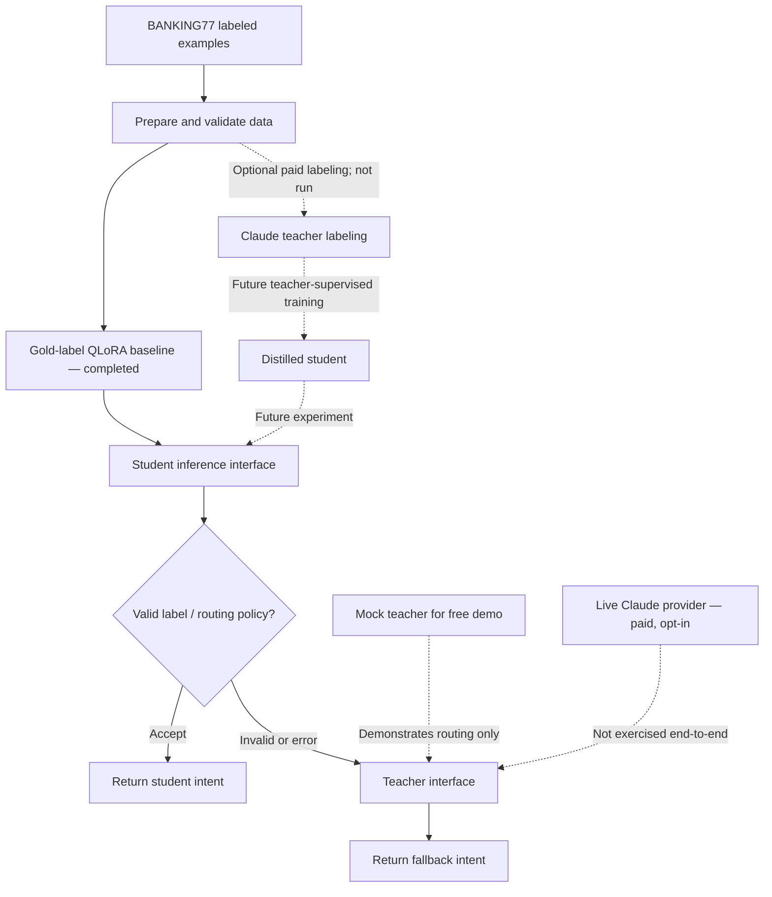

📄 [Project Summary — What I Built](PROJECT_SUMMARY.md)

# Model Distillation Pipeline — Banking Intent Classification

**An engineering prototype for teacher–student intent classification, with a trained Qwen3 student baseline, schema-validated teacher integration, failure-aware routing, and scenario-based unit economics.**

> **Project status:** The Qwen3-1.7B **gold-label supervised baseline** has been trained and evaluated on a development validation sample. The Claude teacher client and routing architecture are implemented, but **live teacher labeling, teacher-supervised distillation, production serving, and end-to-end teacher-versus-student benchmarks have not been completed**. The mock demo is a routing demonstration, **not a model-quality evaluation**.

## At a glance

| Item | Current result / status |
| --- | --- |
| Task | BANKING77 banking-support intent classification (77 classes) |
| Trained student | Qwen3-1.7B, 4-bit NF4 QLoRA, rank 4 |
| Supervision | Original BANKING77 human/gold labels (not Claude-generated labels) |
| Training | One epoch; 241 optimizer steps on Kaggle Tesla T4 |
| Training runtime | 19m 47s (reported training loop) |
| Development evaluation | 382 validation examples |
| Validation accuracy | **50.79%** |
| Validation macro-F1 | **0.5372** |
| Invalid generated labels | **100 / 382 (26.2%)** with open-ended decoding |
| Lowest logged validation loss | **0.2161** (checkpoint 200) |
| Offline test suite | **17 tests passed** |
| Teacher-supervised distillation | **Not run** — Claude API credit unavailable |
| Official 3,080-example test set | **Not evaluated** |

The accuracy and F1 above are **development-validation results, not official held-out test performance**. The training experiment used a lightweight balanced subset rather than the repository's original full-data training plan. See [`results/experiment_summary.json`](results/experiment_summary.json) for recorded values. The reported training-example count (1,925) should be verified against the original Kaggle run before being presented as an exact observed count.

## What the system does

The project investigates when a smaller intent-classification model could handle routine customer-support requests while retaining an escalation path to a more capable teacher model.



The repository also includes [`docs/architecture.svg`](docs/architecture.svg) and [`docs/methodology.md`](docs/methodology.md) from the original design. **Those design artifacts may still reference Qwen3-8B and planned teacher experiments**; treat them as architectural plans until updated to match this experiment.

## Run the offline demo (no GPU, API key, or model download)

Use Python 3.11 or 3.12, from the repository root:

```bash
python -m venv .venv
source .venv/bin/activate
python -m pip install -e '.[dev]'
python -m pytest -q
```

Prepare the public label taxonomy if `data/processed/labels.json` is not already present:

```bash
distill prepare --out data/processed --seed 42
```

Demonstrate the student path **with a mock prediction**:

```bash
python scripts/run_demo.py --text "I lost my bank card"
```

Demonstrate invalid-output escalation **with a mock teacher**:

```bash
python scripts/run_demo.py --text "I lost my bank card" --simulate-invalid
```

The demo uses the real [`InferenceRouter`](src/distill_lab/router.py) but **both providers return configured fixtures**. A correct-looking label in mock mode is not evidence that the trained Qwen model classified the input correctly. The fallback requires no Anthropic credits.

## Training experiment (completed on Kaggle)

- **Base model:** `Qwen/Qwen3-1.7B`.
- **Data:** BANKING77; training sampled at up to 25 examples per label, validation at up to five per label, with exact normalized overlap exclusions. This lightweight sampling differs from the repository's full-data deduplication pipeline.
- **Method:** supervised instruction fine-tuning using **human/gold labels**; 4-bit NF4 QLoRA, rank 4, completion-only loss, one epoch, effective batch size 8.
- **Hardware:** free Kaggle Tesla T4 GPU. The notebook restricted training to one visible GPU and used non-reentrant gradient checkpointing.
- **Artifacts:** a PEFT LoRA adapter and tokenizer, exported from Kaggle; model weights remain local and are **not committed to Git**.
- **Evaluation:** open-ended generated labels were compared against the 77 canonical BANKING77 labels on 382 development examples. Outputs not matching the taxonomy were counted incorrect.

We also explored scoring only permitted candidate labels on a **10-item diagnostic subset**. Five of those ten previously invalid answers became correct, but that selected diagnostic is **not a full comparable evaluation** and is not claimed as the final model score.

**Reproducibility note:** The Kaggle notebook and adapter are not included in this repository at present. To make the completed training run independently reproducible, add the exact notebook/environment and a download or release location for the adapter once those materials are ready. The original [`scripts/train.py`](scripts/train.py) implements the broader teacher-supervised experiment and should not be presented as the exact code used for this lightweight Kaggle result.

## Implemented components versus planned measurements

| Component | Status |
| --- | --- |
| Dataset preparation and taxonomy validation | Implemented |
| Claude API teacher provider and budget-guarded CLI | Implemented; paid execution not completed |
| Gold-label supervised QLoRA baseline | **Trained and evaluated on validation** |
| Teacher-labeled SFT construction | Implemented; no completed live teacher dataset |
| Student prediction adapters | Local Transformers/PEFT provider added; real local inference not validated; vLLM provider available for suitable GPU setup |
| Routing on invalid student output / provider errors | **Demonstrated using mocks** |
| Confidence-threshold escalation | Implemented as experimental policy; not calibrated |
| FastAPI inference API | Implemented; live end-to-end student/teacher service not benchmarked |
| Teacher-vs-student benchmark | Framework implemented; real comparable teacher predictions unavailable |
| Throughput, p50/p95 latency, production SLO | Not measured |
| Cost and break-even model | Implemented; illustrative scenario calculated |

## Economics: illustrative scenario, not observed savings

The [`EconomicsInputs`](src/distill_lab/economics.py) model accounts for always-on GPU rental, operations, variable serving cost and the share of requests escalated to a teacher. The [`results/economics_scenario.json`](results/economics_scenario.json) file uses **hypothetical**, not measured, assumptions:

| Scenario assumption | Value |
| --- | ---: |
| Teacher API cost per request | $0.003 |
| Always-on GPU price | $0.50/hour |
| Teacher escalation fraction | 25% |
| Operations overhead | $1/day |
| Daily request volume for comparison | 10,000 |

| Calculated scenario result | Value |
| --- | ---: |
| Teacher-only cost at 10,000 requests/day | $30.00/day |
| Student + fallback at 10,000 requests/day | $20.50/day |
| Difference in this hypothetical scenario | $9.50/day |
| Break-even threshold (model assumptions) | 5,778 requests/day |

**These are not cloud quotes, invoices, actual teacher usage, verified escalation rates or demonstrated savings.** No deployment throughput was measured, so the calculated break-even might be infeasible within real latency requirements. The model's cost assumptions can be changed to explore other workloads.

## Repository guide

| Path | Purpose |
| --- | --- |
| `src/distill_lab/data.py` | Dataset splits and leakage checks |
| `src/distill_lab/providers.py` | Claude teacher and vLLM student adapters |
| `src/distill_lab/local_student.py` | Optional local Transformers/PEFT inference adapter (not required for mock demo) |
| `src/distill_lab/router.py` | Student acceptance and teacher fallback logic |
| `src/distill_lab/api.py` | FastAPI inference surface |
| `src/distill_lab/metrics.py` | Quality and invalid-output metrics |
| `src/distill_lab/benchmark.py` | Requires aligned real teacher/student prediction files |
| `src/distill_lab/economics.py` | Always-on GPU and fallback cost model |
| `scripts/run_demo.py` | Free offline router demonstration |
| `scripts/serve_vllm.sh` | Optional GPU serving entrypoint; review defaults against your actual adapter before use |
| `results/` | Recorded training/validation results and illustrative economics |
| `docs/` | Original architecture and methodology design documentation |
| `tests/` | Offline regression tests |

## Limitations and next steps

1. **No completed knowledge-distillation run:** training used human labels, not outputs from Claude. Calling the completed model a *distilled* student would misstate the experiment.
2. **Validation is not final testing:** results came from a development subset that was also used for checkpoint selection. The official test split is still reserved.
3. **Unconstrained label generation:** 100/382 validation predictions were not canonical label names. The router may escalate invalid outputs, but that escalation behavior has not been measured with a real teacher.
4. **Mock mode is a software demo, not AI quality evidence:** mock predictions are configured examples, and near-zero mock latency must not be reported as real model latency.
5. **Serving and ROI are unverified:** real GPU inference throughput, token cost and teacher fallback rate are missing. An always-on GPU can be uneconomical at low volumes.
6. **Original roadmap versus current implementation:** Qwen3-8B/rank-8/rank-32 comparisons, W&B runs and real vLLM load testing remain optional future work, not completed findings.

The next evidence-oriented milestones are to publish the exact Kaggle notebook and adapter location, run a reproducible *student-only* inference benchmark on a GPU, and, only if API credits become available, gather a small teacher-labeled set for a genuine distillation comparison.

## Responsible use

- No raw customer data or credentials should be committed. The public BANKING77 dataset is downloaded during preparation; model weights and generated data are excluded from Git.
- Claude API calls are opt-in and cost guarded, but account-level billing limits still matter.
- Operational routing telemetry is designed not to include customer text. Real deployment requires authentication, access controls, rate limiting, secure networking and privacy review.
- This is a prototype intent classifier, not a production banking or financial-advice system.

## Dataset attribution

BANKING77 / PolyAI: [Hugging Face dataset](https://huggingface.co/datasets/PolyAI/banking77). Casanueva et al. (2020), *Efficient Intent Detection with Dual Sentence Encoders*. Dataset license: CC BY 4.0.
